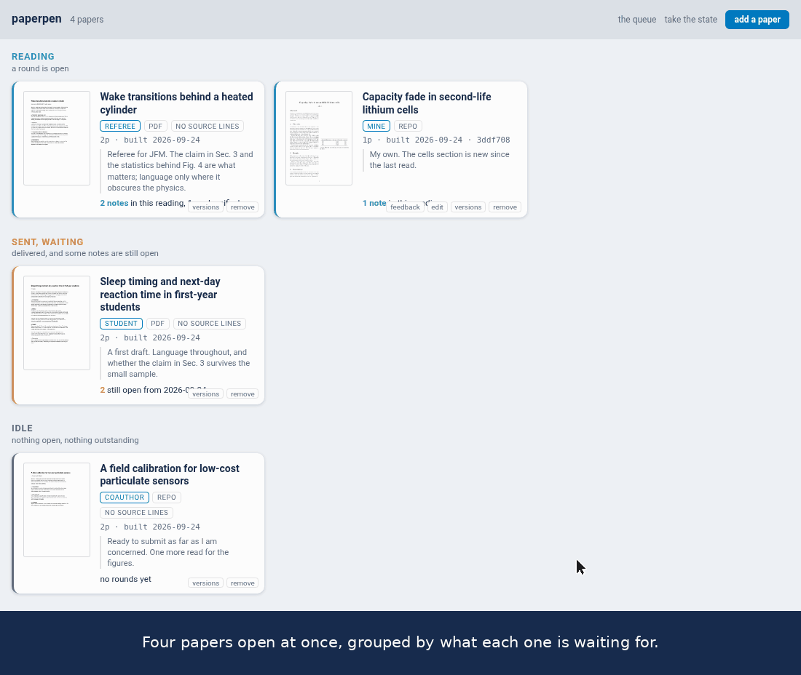
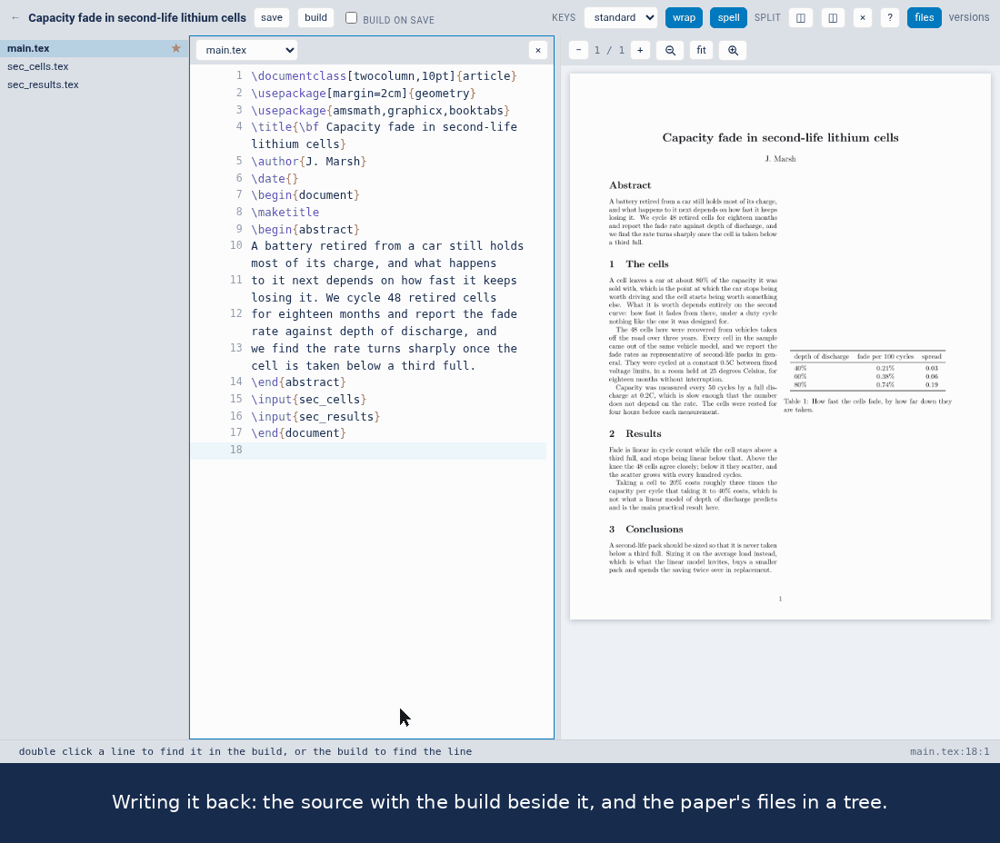
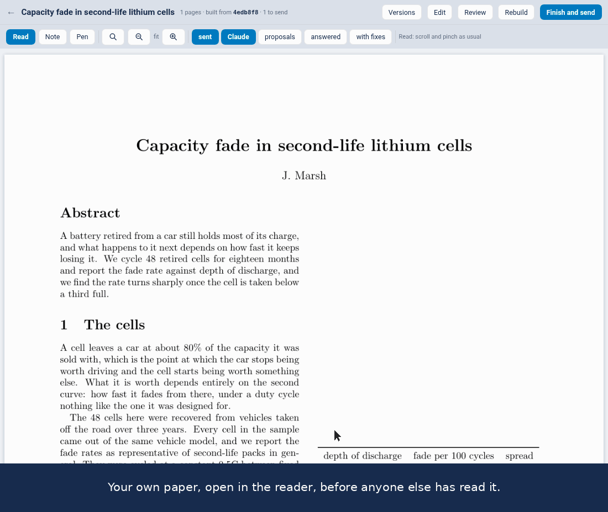

# paperpen

by [acorbe](https://github.com/acorbe)

[](https://ko-fi.com/V3Y22788IC)
[](LICENSE)
[](pyproject.toml)
[](https://github.com/acorbe/paperpen/actions/workflows/tests.yml)
[](https://acorbe.github.io/paperpen/)

Read a paper on a tablet, mark it up with a pen, and get the marks back as
something you can act on: a note anchored to the line of LaTeX that made the
sentence, or a marked-up PDF to send to whoever wrote the paper.



The manual, with pictures of every screen: **https://acorbe.github.io/paperpen/**

## Quick start

```sh
git clone https://github.com/acorbe/paperpen.git
cd paperpen
uv run paperpen onboard            # the login, a certificate, a first paper
uv run paperpen add ~/papers/draft # a LaTeX repository, a folder, or a PDF
uv run paperpen serve --lan        # over https, with a QR code for the tablet
```

It needs Python 3.10 or newer, `latexmk` and `synctex` for a paper with LaTeX
behind it (a PDF needs neither), `git` for a paper delivered into its
repository, `openssl` or the `cryptography` package for the certificate, and
`aspell` if the editor is to check spelling.
`paperpen onboard --check` says which of these are there. It runs from its
checkout, which `uv run` takes care of; [docs/running.md](docs/running.md) says why and
how to install it for use from any directory.

You read several papers at once, so the app is built around that. The **shelf**
groups them by what each one is waiting for (a round open, a round delivered
with notes still unanswered, nothing outstanding), and each card carries the
paper's first page, because a shelf is recognised by its first pages long
before it is read by its titles. The **queue** is every open note from every
paper in one list, which is where the classifying gets cleared. Every one of them, and the paper
itself and its source, can be searched with a few words in any order, and a
search lists every match to jump to, the way emacs's occur does.

A paper's notes leave the way its reader needs them. Your own manuscript
commits `review/<date>/` into its own repository. A student's draft becomes a
PDF with every note in the margin, because what you send a student is a file.

And the round comes back. An agent working in the paper's repository answers
each note with a fix, exact LaTeX and what replaces it, or with a question,
and the fixes appear in the notes themselves: the pin of a note with a fix
waiting is ringed, the note shows the diff, and one tap on **Use this** puts it
into the source and opens the next note that has one. Nothing is committed
until you do it; the versions view shows what the working tree now says.

Or you write it back yourself: a line edited beside the build, the build
asked where that line landed, and the versions view with latexdiff against the
last commit.



```sh
paperpen add <repo-or-pdf>     # find the main .tex, build it, put it on the shelf
paperpen serve                 # the shelf and the reader, at 127.0.0.1:8770
paperpen shelf                 # the same view, in the terminal
paperpen about <paper>         # its kind, its brief, where a finished round goes
paperpen forget <paper>        # take it off the shelf; repo, rounds and cache stay
paperpen notes <paper>         # every note, and whether it is closed
paperpen finish <paper>        # close the open round and deliver it
paperpen feedback <paper>      # the fixes proposed for its notes, and the questions
paperpen propose <paper> <note> --summary S --file F --old O --new N
                               # what the agent answering a round runs
paperpen review <paper> [--focus "clarity, notation"] [--max N]
                               # the agent reads it first and writes notes of its own
paperpen approve <paper> <note>  /  paperpen reject <paper> <note>... [--why W]
```

## After Finish and send

**Finish and send**, or `paperpen finish`, closes the round and commits
`review/<date>/` into the paper's repository. The notes are then answered in
the paper's checkout by an agent: paperpen starts one for you (next section),
or you start a session by hand and point it at the round, which any LLM that
can run a shell command will do; Claude Opus is what we have used. It can
propose, which is what the film shows and what you then choose from in each
note:

```text
Work through review/<date>/NOTES.md in this repository, and change nothing.
For each note propose one fix, or two when there is a real choice, with
  paperpen propose <paper> <note-id> --by claude --summary "..." --why "..." --edits - <<'EOF'
  [{"file": "main.tex", "old": "the exact text there now", "new": "what replaces it"}]
  EOF
and where you cannot decide, ask with paperpen reply <paper> <note-id> --by claude "...".
Read each note's thread first; for a handwritten note, read its ink/<id>.png.
```

### Running the agent

paperpen runs it for you, on the machine that serves paperpen. The agent is
Claude Code by default, and OpenAI Codex with `--runner codex`; whichever it
is has to be installed there and signed in, and `paperpen onboard --check`
says which are and which one is in force. Then, for a paper whose round has
been sent, in paperpen's checkout:

```sh
uv run paperpen list                              # the paper's id, first column
uv run paperpen agent <paper>                     # run it now, here, and watch it work
uv run paperpen agent <paper> --print             # or print the command, to paste anywhere
uv run paperpen about <paper> --agent implement   # or have Finish start it every time
uv run paperpen about <paper> --runner codex      # Codex for this paper; PAPERPEN_RUNNER for all
```

Claude Code is given a list of what it may do, paperpen's own commands and
reading files, and nothing else. Codex has no such list, so it runs in its
`workspace-write` sandbox instead: it can write the paper's checkout and
paperpen's own data and cache, and is told not to commit.

It applies what leaves no choice, the way most handwritten corrections are,
and proposes or asks about the rest. What it did shows in each note with an
**Undo**, and **Commit** in the reader takes it into history, on a branch of
its own if you like. All of it is in [docs/agents.md](docs/agents.md).

### The agent reading first

The other way round: `paperpen review <paper>`, or **Review** in the reader's
header, has the agent read the paper on its own and write notes, each anchored
to its sentence and carrying the fix it would make. They come in a round of
their own, `review/<date>-claude/` or `review/<date>-codex/` after whichever
agent wrote them, in the agent's colour, and you approve or reject each one,
or a selection of them on the Fixes page. An approved fix goes into the working tree, nothing is
committed, and a rejection's reason is kept so the next run does not propose it
again. See [docs/agents.md](docs/agents.md#the-agent-reading-first).

Review with a focus, the notes arriving in Claude's colour with their pins
ringed, one fix approved, the next rejected with a reason, and the Fixes page:



## What is here, and what is not

Working:

- the shelf, the queue, and `paperpen next` for something standing above the
  papers
- the reader: notes typed or handwritten, anchored through SyncTeX to the line
  of LaTeX, and a note already taken changed again, its handwriting in the pad
  and its ink on the page, with an undo that takes back a rub-out too; only
  the notes still waiting are drawn, unless asked for the answered ones
- the answer to a round: fixes proposed for its notes, by an agent or a
  person, chosen in the note itself with one tap, the next note opening, or
  all together at `/paper/<id>/feedback`; a question and its reply kept in
  the note's thread
- rounds recorded whatever their delivery was, and delivered as a commit, a
  folder or a marked-up PDF
- writing the source with the build beside it, SyncTeX in both directions: a
  file tree, the main file chosen among several, standard or emacs keys, the
  build scrolled through page by page, and Ctrl and the wheel zooming one
  panel at a time
- the paper beside its own past in four panes, latexdiff between them, and
  notes taken there on the newest version or on the diff with it
- the tablet, an iPad included: served over https behind a login (a password, and a
  second factor paired by scanning a QR code), a QR code to connect,
  the panes two by two when it is held upright, a swipe to turn the page, a
  pinch that zooms the paper and not the page, and a Pencil that writes where
  it touches
- papers put on the shelf and taken off it from the shelf page, and
  `paperpen onboard` for the basics of a new machine

Not yet: handwriting transcribed to text. `DESIGN.md` says what it will be.

## More

- [docs/running.md](docs/running.md): running it, and the tablet over the
  network, with the login choices and the certificate
- [docs/writing.md](docs/writing.md): the source with the build beside it, and
  the paper beside its own past
- [docs/agents.md](docs/agents.md): after a round, and an agent above the papers
- [docs/papers.md](docs/papers.md): what a paper's own repository needs to
  know, which `paperpen howto` prints
- [docs/data.md](docs/data.md): where everything lives, and taking it elsewhere
- [docs/development.md](docs/development.md): the manual, the demo, and where
  the code comes from
- [the manual](https://acorbe.github.io/paperpen/), the same ground for a
  reader rather than a developer, online; `manual/` is the same site to open
  from the checkout
- [DESIGN.md](DESIGN.md), what it is for and what it will be

## Licence

MIT. See `LICENSE`.

Written by Alessandro Corbetta, a physicist, who reads drafts on a tablet and
was tired of the notes never making it back to the source. If paperpen saves
you a round trip, a coffee is always welcome ☕

[](https://ko-fi.com/V3Y22788IC)
